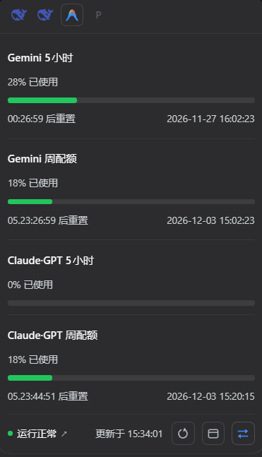
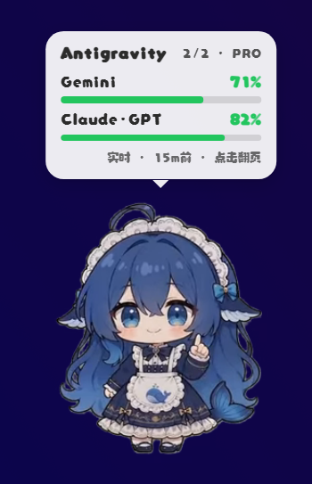

# dsh-antigravity-balance

为 [Antigravity-Manager (Antigravity Tools)](https://github.com/lbjlaq/Antigravity-Manager) 提供 DeepSeek Harness (DSH) 余额与配额展示适配插件，同时支持以下两款 DSH 插件（均无需修改它们的源码）：

- **[dsh-pet](https://github.com/PC2005-cloud/dsh-pet)**：桌宠 3 页自定义余额气泡与 6 档余额动画。
- **[dsh-model-allowance](https://github.com/MeiK2333/dsh-model-allowance)**：输入框旁额度徽标、多窗口明细卡片、平台状态灯、官方 Antigravity 矢量图标及控制台快捷拉起。

## 效果预览

| dsh-model-allowance 额度卡片 | dsh-pet 桌宠余额气泡 |
| :---: | :---: |
|  |  |

## 核心特性

- **双插件可选适配，互不依赖**：通过 Cordis 可选依赖注入分别挂载 `petApi7340`（[dsh-pet](https://github.com/PC2005-cloud/dsh-pet)）与 `modelAllowance`（[dsh-model-allowance](https://github.com/MeiK2333/dsh-model-allowance)），只装其中一个或同时安装均可正常工作。
- **零侵入设计**：不修改 `dsh-pet` 或 `dsh-model-allowance` 源码，卸载时自动清理路由、样式与桥接包装。
- **保留用户 Token 用量统计**：独立配置 `ANTIGRAVITY_ADMIN_KEY` 查询 `/api/accounts` 管理接口，不干扰 DSH 对话继续使用 `ANTIGRAVITY_API_KEY`（用户 Token）分用户统计用量。
- **纯 HTTP 通信，不读外部本地文件**：管理接口地址动态提取自 DSH 中 `antigravity` 服务商的 `baseURL`，绝不读取 `~/.antigravity_tools/` 下的任何本地文件。
- **内置 DSH 设置页（设置 → Antigravity 余额）**：
  - 安全配置、测试与清除 `ANTIGRAVITY_ADMIN_KEY`（写入 DSH 凭证存储并同步环境变量）；
  - 可选配置本地 **Antigravity Tools** 可执行文件（`.exe` / `.lnk`）路径，点击 [dsh-model-allowance](https://github.com/MeiK2333/dsh-model-allowance) 卡片中的控制台按钮即可直接拉起客户端（留空则回退为打开管理网页）。

## 展示内容

### 1. [dsh-pet](https://github.com/PC2005-cloud/dsh-pet) 桌宠余额气泡（点击循环翻页）
- **第 1 页**：`Gemini`、`Claude·GPT` 模型组余量与彩色进度条、可用账号数与订阅等级徽标；
- **第 2 页**：各模型组 `5h` / `周` 窗口余量及重置倒计时；
- **第 3 页**：账号池明细（完整用户名 + 换行展示各模型组余量，标记当前活跃账号）。

### 2. [dsh-model-allowance](https://github.com/MeiK2333/dsh-model-allowance) 额度卡片
- 顶部切换栏与溢出菜单自动展示官方 Antigravity 透明底彩色矢量图标；
- 展示 `Gemini 5小时` / `Gemini 周配额` / `Claude·GPT 5小时` / `Claude·GPT 周配额` 窗口余量、重置倒计时与本轮消耗差值；
- 状态服务实时反映账号池健康度（`operational` / `degraded` / `major-outage`），状态链接指向 `https://aistudio.google.com/status`。

## 安装

### 方式一：通过 DSH CLI 安装（推荐）

支持 `web` profile，在终端运行：

```bash
dsh plugin --profile web add github:DR34M3R-T/dsh-antigravity-balance
```

### 方式二：在 DSH 插件页通过 Git 安装

在 DSH 侧边栏打开 **插件 → 安装**，填入：

```text
git+https://github.com/DR34M3R-T/dsh-antigravity-balance.git
```

### 方式三：本地目录软链接安装

将本仓库放到本地目录（例如 `~/.dsh/plugins/dsh-antigravity-balance`），并在 DSH `web` profile 中安装或 `link:` 引入，随后重启 DSH。

## 兼容与权限说明

- **支持 Profile**：`web`
- **DSH 兼容版本**：DeepSeek Harness `>=0.2.1`
- **网络与外部服务**：仅向你在 DSH 中为 `antigravity` 配置的 `baseURL` 对应的 `/api/accounts` 发起 HTTP 请求（用于读取账号池配额）；状态页跳转链接指向 `https://aistudio.google.com/status`。
- **本地存储与权限**：
  - `ANTIGRAVITY_ADMIN_KEY` 保存在 DSH 官方凭证存储中，绝不回显明文；
  - 可选的「控制台快捷启动」路径保存在 `~/.dsh/antigravity-balance-config.json`，仅在你手动点击控制台按钮或测试拉起时启动所选本地程序；
  - 绝不读取 `~/.antigravity_tools/` 下的任何本地应用文件。

## 使用配置

1. 确保已在 DSH「设置 → 模型」中配置了 `antigravity` 服务商及其 `baseURL`（例如 `http://127.0.0.1:8080/v1`）。
2. 重启 DSH 后，打开 **设置 → Antigravity 余额**：
   - 填入 [Antigravity-Manager](https://github.com/lbjlaq/Antigravity-Manager)「API 反代」页面的 **主 API Key**（或 Web 管理密码），点击 **保存 → 测试连接**；
   - （可选）在「控制台快捷启动（Antigravity Tools）」卡片中点击 **选择程序…** 指定 `Antigravity Tools.exe`。
3. 选中 `antigravity` 下的模型即可在 [dsh-model-allowance](https://github.com/MeiK2333/dsh-model-allowance) 卡片中查看实时额度，或通过 [dsh-pet](https://github.com/PC2005-cloud/dsh-pet) 右键 **查看余额** / `/balance` 呼出桌宠气泡。

## 许可

MIT
